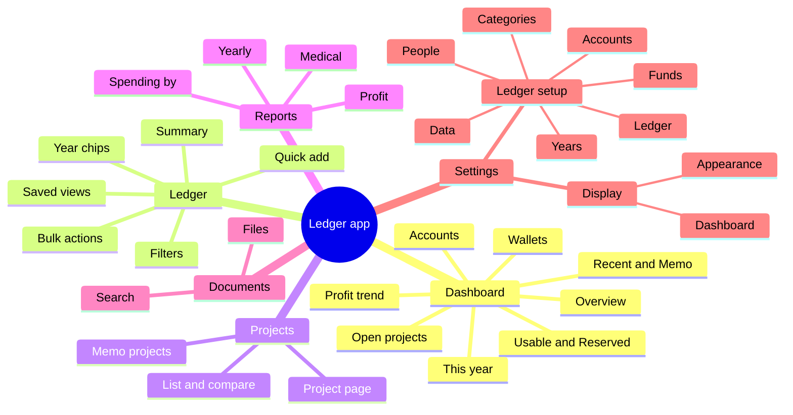
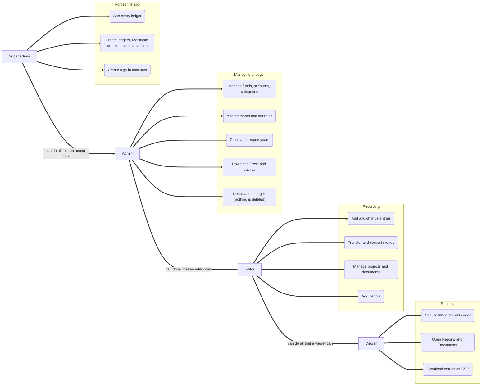
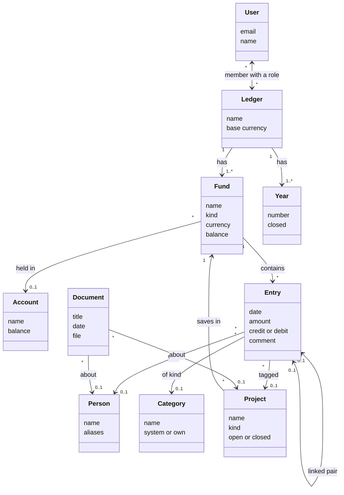
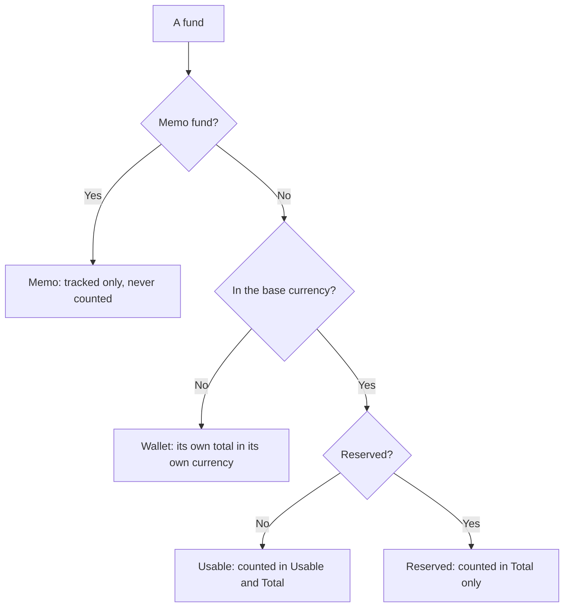
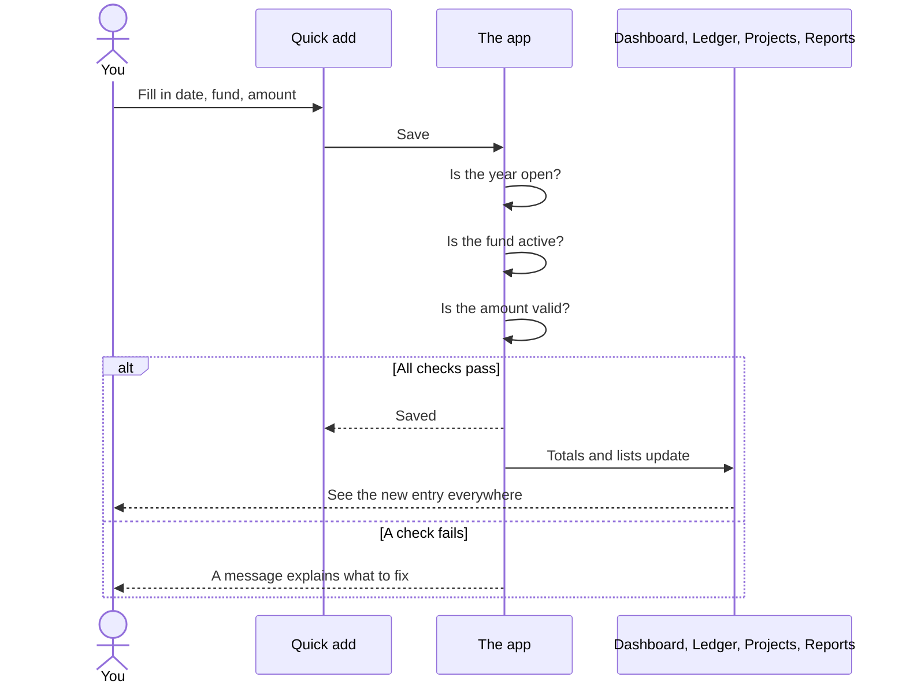
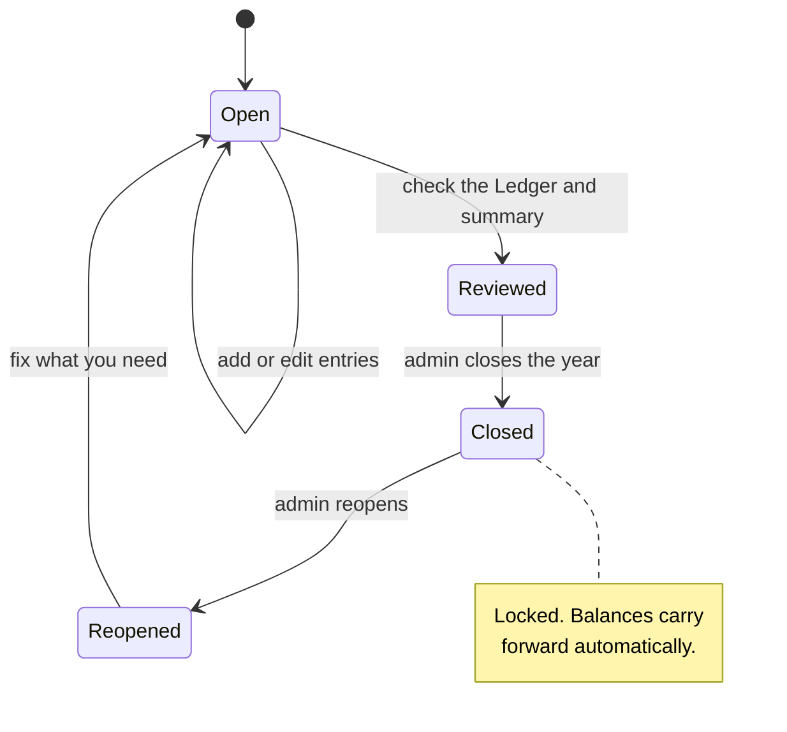
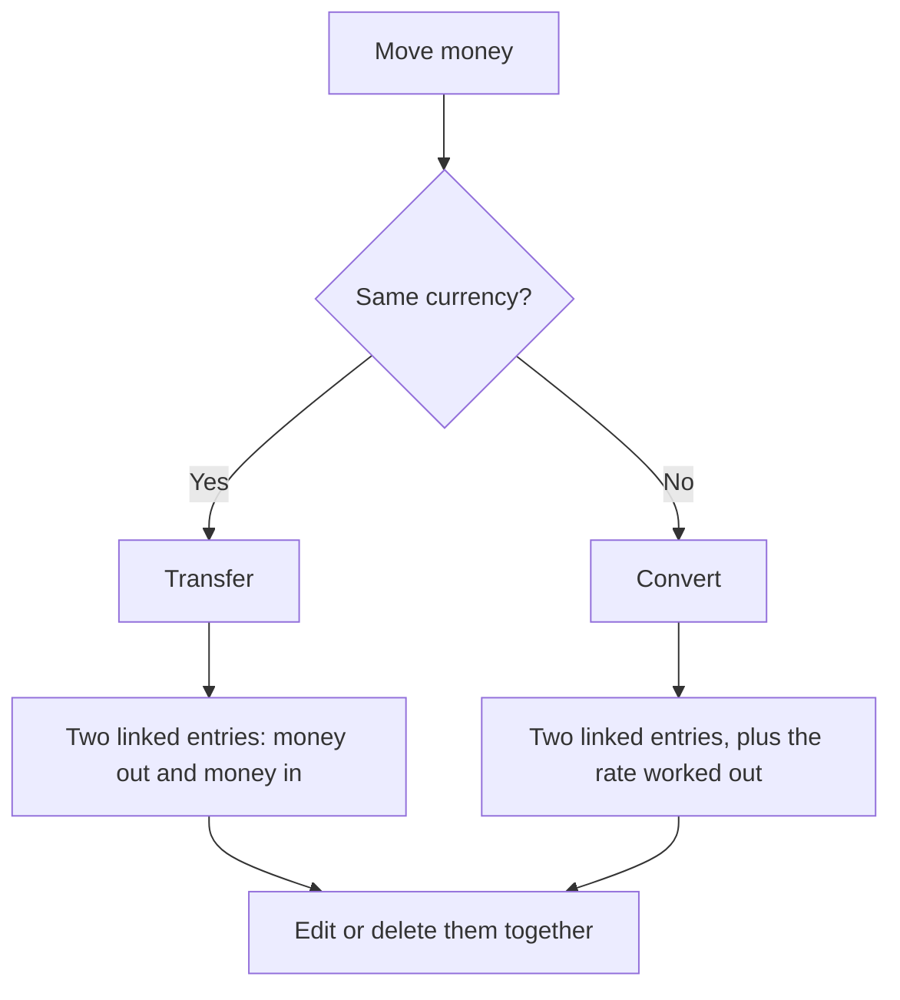
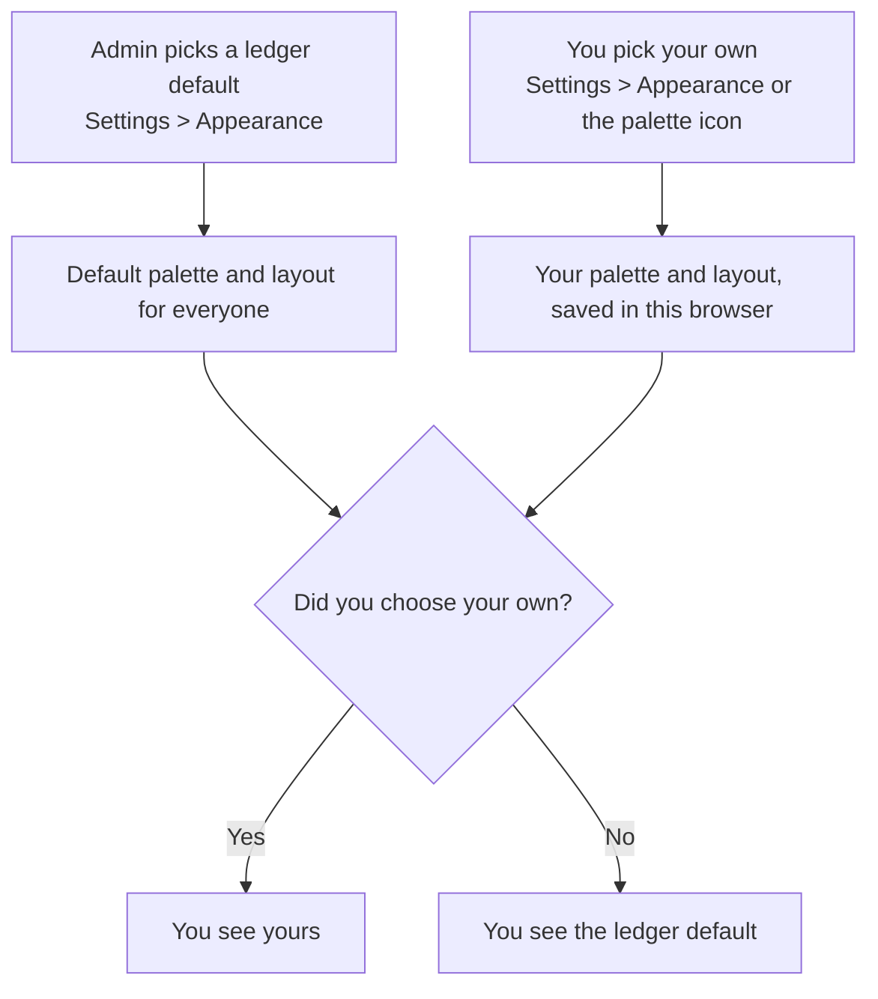

# Ledger: App Map

A picture-first tour of the app. Each diagram has a short explanation below it. For step-by-step help, see the [User guide](USER_GUIDE.md). A new install has no data: the first super administrator creates a ledger with **New ledger** (see [Getting started](GETTING_STARTED.md)).

## 1. What's in the app

The app has six areas. The Dashboard tells you where you stand. The Ledger is the full list of entries. Projects group entries for a trip or a medical case. Reports add things up over the years. Documents keeps files such as prescriptions. Settings holds the lists and rules that the other areas use, and how the app looks.

## 2. Who can do what

Every role can do everything the role below it can, which is shown by the arrows between the people. Viewers only read. Editors also record money and manage projects and documents. Admins look after the ledger itself: its funds, members, year locks, profit settings and default look. A super admin looks after the whole app: all ledgers and sign-in accounts. Roles are set for each ledger.

## 3. How the pieces fit together

A ledger (book) holds funds. A fund can sit in an account, such as a bank account, and contains entries. Each entry can name a person, a category and a project. A project saves its entries in one fund. A transfer or conversion is two entries linked to each other. Each ledger has years that can be closed. Documents can belong to a project and a person. Users are members of ledgers, each with a role.

## 4. Kinds of funds

Every fund counts in exactly one way. Money in the base currency is either Usable (spendable) or Reserved (set aside), and both add up into Total. A fund in another currency is a Wallet with its own total, never mixed with the rest. A Memo fund is only for information and is never part of your money.

## 5. Life of an entry

When you press Save, the app checks three things: the year is not locked, the fund is not disabled, and the amount is a valid number above zero. If all is well, the entry is saved and every screen shows it straight away. If not, a message tells you what to change.

## 6. A year in the app

A year starts open, and you add and edit entries freely. At year end you review it, and an admin can close it, which locks its entries. Closing is a safety lock, not a required step: balances carry into the next year by themselves. If you must change something, an admin reopens the year, you fix it, and it can be closed again.

## 7. Moving money

Use Transfer to move money between two funds in the same currency, and Convert to move it between funds in different currencies, such as a 50,000 amount in one currency becoming a smaller amount in another. Either way the app saves two linked entries, one out and one in. They are changed or deleted together, so the books never get out of step.

## 8. Where to find things

```mermaid
flowchart TD
  TOP["Top bar: ledger switch, pages, account menu"]
  TOP ==> D["Dashboard"]
  TOP ==> L["Ledger"]
  TOP ==> PR["Projects"]
  TOP ==> DO["Documents"]
  TOP ==> RE["Reports"]
  TOP ==> SE["Settings"]
  TOP ==> AM["Account menu"]
  D ==> D1["Customize, Add wallet"]
  L ==> L1["Add entry, year chips, More filters"]
  L ==> L3["Tick rows for bulk actions"]
  L ==> L2["Save view, Views, Include previous balance"]
  PR ==> P1["New project, Compare"]
  PR ==> P2["Project page: View in Ledger, Close, move entries to the fund"]
  DO ==> DO1["Add document"]
  DO ==> DO2["Link to entries: Entries field, or Attach document on an entry"]
  RE ==> R1["Yearly, Spending by, Profit, Medical"]
  TOP ==> PM["Palette menu"]
  SE ==> S1["Ledger setup: Funds, Accounts, Categories, People with entry counts"]
  SE ==> S2["Ledger setup: Years: Check, Close, Reopen"]
  SE ==> S3["Ledger setup: Data: CSV, Excel, Backup"]
  SE ==> S4["Ledger setup: Ledger: name, members"]
  SE ==> S6["Display: Appearance, Dashboard view"]
  PM ==> PM1["Your own palette and layout"]
  AM ==> A1["New ledger, Sign out"]
```

Everything starts from the top bar. Each page has its own tabs and a few main buttons, shown here. Settings groups its tabs under Ledger setup and Display. The palette icon in the top bar changes your own look without opening Settings. If you cannot see a button, your role probably does not allow it.

## 9. Choosing a look

There are 13 palettes and two layouts for the Settings lists, Cards or Table. An admin sets the ledger default for everybody. Anyone can override it for themselves, and that choice stays in their own browser and does not change what others see. The Dashboard can also show its amounts as a list, pie, bars or graph (Settings > Dashboard), again per person.

## 10. Coming from a spreadsheet

If you kept your money in a spreadsheet, start by creating the funds and categories in Settings, then add your entries (or bulk-add them), and use the year chips and the Summary instead of one sheet per year.

## Cheat sheet

| I want to... | Go to... | Click... |
| --- | --- | --- |
| See how much I can spend | Dashboard | Look at **Usable** |
| See which account holds which funds | Dashboard | **Accounts** section |
| Change the colours | Settings > Appearance, or the palette icon in the top bar | Pick a palette |
| See how many entries a fund, person or category has | Settings > Funds, Accounts, Categories or People | The count on each card or row |
| Show the Dashboard as a pie, bars or graph | Settings > Dashboard | Pick a view |
| Exclude an entry from totals | A project (or open the entry in Ledger) | The small switch at the right of the row |
| Add money received | Ledger | **Add entry** > **Remittance** |
| Record an expense | Ledger | **Add entry** > **Expense** |
| Move money between funds | Ledger | **Add entry** > **Transfer** |
| Change currency | Ledger | **Add entry** > **Convert** |
| Find an entry | Ledger | Fund / Category / People / Project filters |
| Look at one year | Ledger | A year chip |
| Look at all years | Ledger | **All years** |
| See last year's balance | Ledger | Pick a year, tick **Include previous balance** |
| Keep a filter for later | Ledger | **Save view** |
| Correct an entry | Ledger | The row, then **Save** |
| Change many entries at once | Ledger or a project | Tick the boxes at the left of the rows |
| Start a trip or case | Projects | **New project** |
| See a project's rows in the Ledger | Projects > the project | **View in Ledger** |
| Compare projects | Projects | Tick them, read the summary |
| Add a foreign-currency wallet | Dashboard | **Wallets** > **Add wallet** |
| Add a currency | Admin > Currencies (super admin) | **Add currency** |
| Give a currency a short label, such as kr | Admin > Currencies (super admin) | **Alias**, then **Save** |
| Switch a currency off | Admin > Currencies (super admin) | **Off** on its row |
| Choose which account holds a fund | Settings > Funds | Edit the fund, set **Account** |
| Store a prescription | Documents | **Add document** |
| Link a document to entries | Documents > Add document or Edit document | **Entries** field |
| Link a document to an entry | Ledger > click the entry's row | **Documents** section, **Attach document** |
| Remove a document link from an entry | Ledger > click the entry's row | **Unlink** next to the document |
| See which rows have documents | Ledger | The paperclip with a number |
| See profit by month | Reports | **Profit** tab |
| Download my data | Settings > Data | CSV, Excel or Backup |
| Lock a finished year | Settings > Years | **Close** |
| Add a team member | Settings > Members | **Members**, email, role, **Add** |
| Start a new ledger | Sidebar or account menu | **New ledger** |
| Hide a ledger for a while | Settings > Details | **Deactivate ledger**, type the name |
| Bring back a hidden ledger | Settings > Details, or Administration > All ledgers (super admin) | **Enable** (Administration) or **Reactivate** (Settings), type the name |
| Hide a ledger from the side panel | Administration > All ledgers (super admin) or Settings > Details | **Disable** |
| Delete a ledger and all its data | Administration > All ledgers (super admin) | **Delete**, type the name |
| Add an admin who manages only one ledger or loan | Admins (super admin) | **Add admin**, Super admin off, pick ledgers, loans and pages |
| Make someone a super admin (or back) | Admins > the admin's card | **Make super admin** / **Make normal admin** |
| Make a read-only login for someone | Administration > Access codes | **New access code**: view only, never Settings or any editing |
| Rename a page (for example Item Vault) or go back to defaults | Settings > Page names (ledger admin) | Type a name, **Save names**, or **Use default** / **Reset all to defaults** |
| Copy an entry, document, note, item, loan or project | The record's row, card or edit form | **Duplicate**, adjust, **Save** |
| Create a notebook, linked to a ledger or private | Notebook | **New notebook**, choose the linked ledger (or none, super admin only) |
| Write down a note or thought | Notebook > a notebook | **New entry** |
| Remember an important date (anniversary, first service) | Notebook | **New entry**, switch on **Important date**, then **Repeats every year** |
| Group dates and notes under a person or topic | Notebook | **New category**, or type a category in the entry |
| See what is coming up | Notebook > Upcoming | the strip at the top |
| Hide or bring back an entry | Notebook | **Disable** or **Enable** |
| Share a notebook, loan or item with other ledgers | The form of the record | **Also share with** switches; only the main ledger can edit it |
| Move a record to another main ledger | The form of the record | Change **Ledger** (Admin in both ledgers) |
| See where a record is shared | Its card | The two-people badge, hover for details (loans in no ledger show **All**) |
| Give an access code its own pages or notebooks | Settings > Access or Administration > Access | **Own pages**, **Only / All except** notebooks |
| See a code again | Administration > Access (super admin) | **Show code** |
| Rearrange the Dashboard | Dashboard | **Customize** |
| Create a loan | Loans | **New loan** |
| Add a loan taken | Loans > the loan | **Add entry**, then **Loan taken** |
| Add a repayment | Loans > the loan | **Add entry**, then **Loan returned** |
| See what is still owed | Loans | **Remaining** on each card, or **Remaining balance** at the top of a loan |
| Close a loan that is fully paid back | Loans > the loan (loan admin) | **Mark as settled** (needs zero remaining); **Reopen loan** to undo |
| See settled loans | Loans | **Show settled loans** switch |
| Give someone access to one loan | Administration (super admin) | **Edit loan access**, set the role for that loan |
