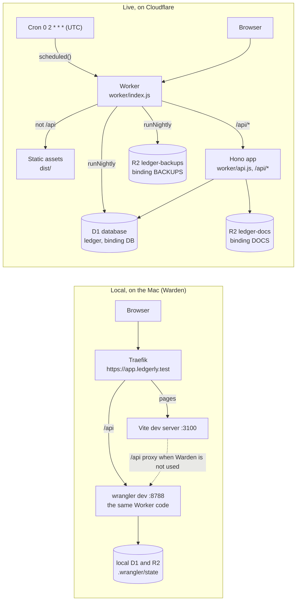
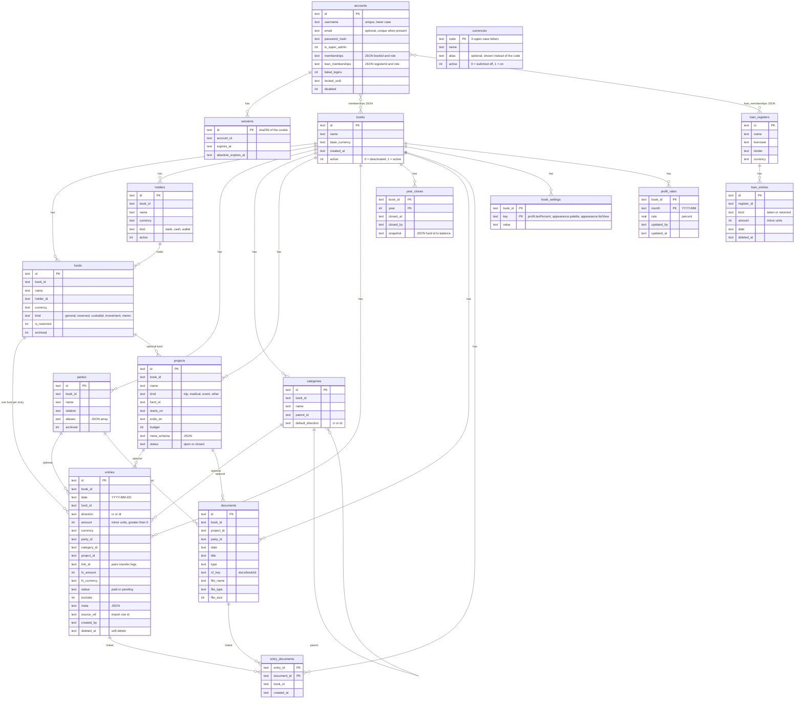
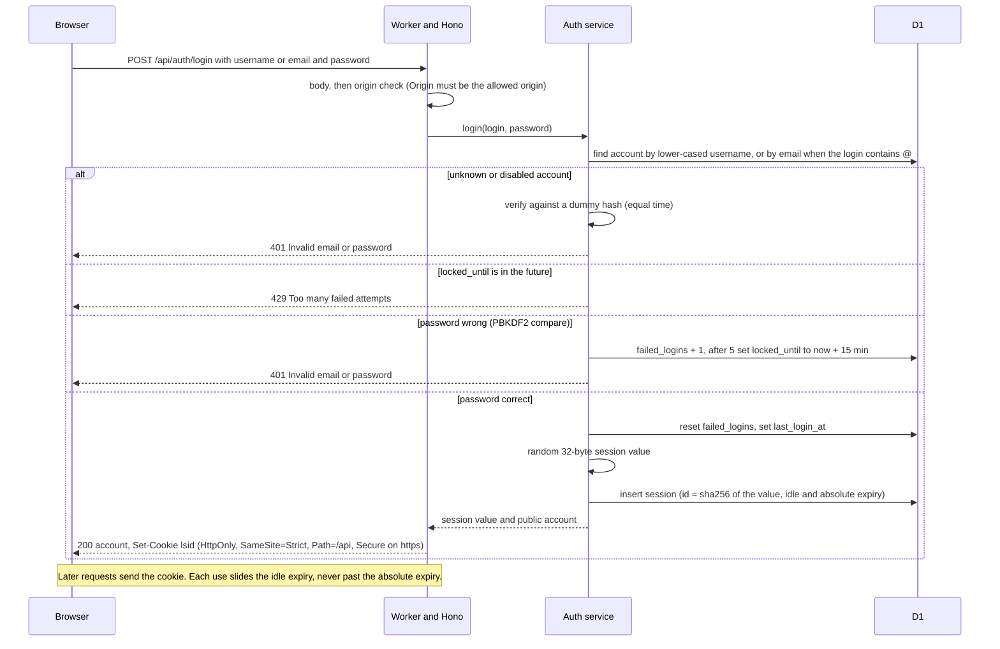
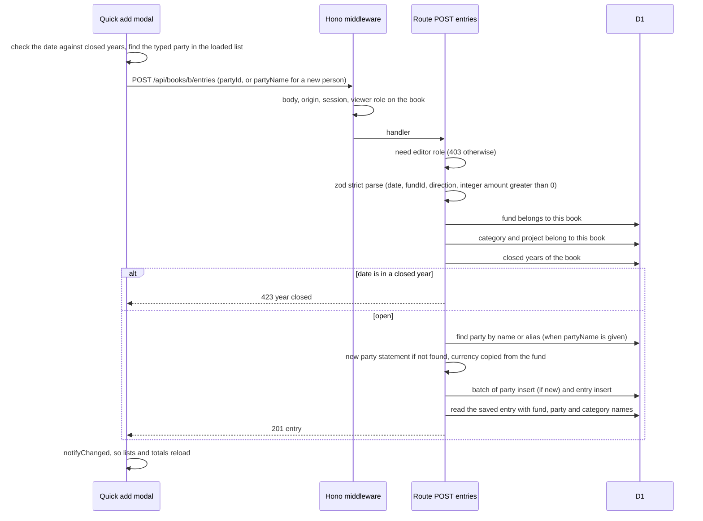
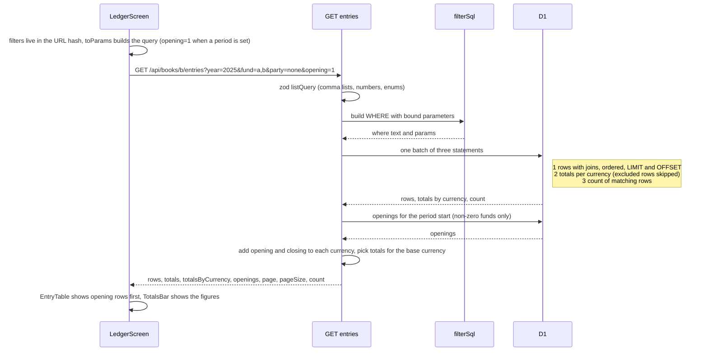
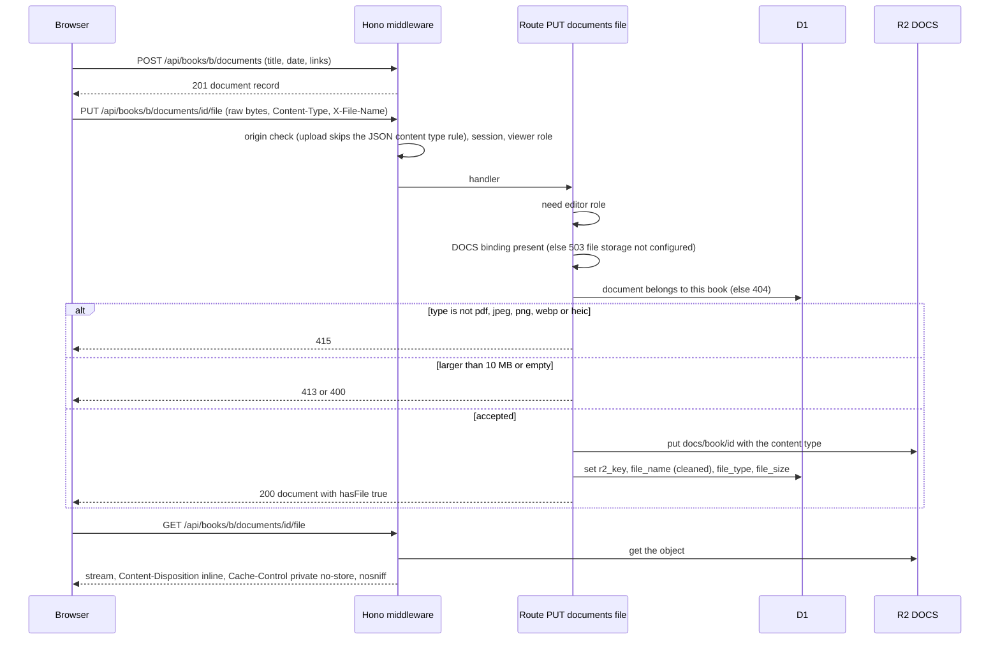
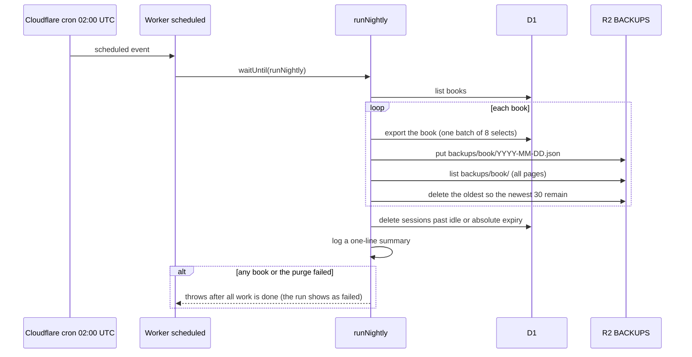
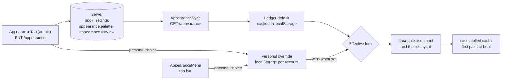
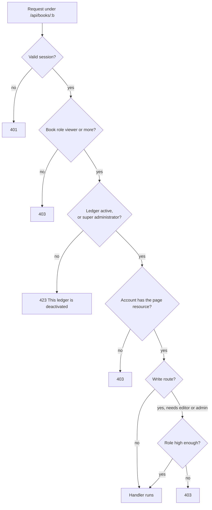

# Ledger: how it fits together

This page explains the parts of the Ledger app and how they connect. Read it first if you are new to the project. It is written from the code.

Ledger keeps the money of a family or a company in one place. It runs only on **Cloudflare**, both locally and live: a Worker for the code, a D1 database for the data and R2 buckets for files.

Related pages: `USER_GUIDE.md` (using the app), `OPERATIONS.md` (running, backups, tests), `DEPLOYMENT.md` (getting it to Cloudflare).

---

## 1. Purpose and principles

| Principle | What it means in the code |
| --- | --- |
| **One continuous dated ledger per book** | A *book* is one ledger (a family, a person, a company). Every row in every table carries `book_id`. All queries are scoped by it. There is one `entries` table, not one sheet per year. |
| **Integer minor units** | Money is stored and sent as integers: paisa, cents, ore. `1032629` means 10,326.29. There is no floating point money anywhere. Only the screen formats it (`src/utils/money.js`), and the CSV export (`server/csv.js`) turns minor units into decimals with integer arithmetic. |
| **Years are filters plus locks** | A year is not a table or a tab. It is a date range filter on the ledger (`year=2025`). Closing a year stores a balance snapshot in `year_closes` and makes writes dated in that year fail with 423. An admin can reopen it. |
| **Linked transfers** | A transfer or a currency conversion is always two rows that share a `link_id`: a debit on the source fund and a credit on the target fund. They are created, edited and deleted together. |
| **Memo funds** | A fund of kind `memo` holds money that is tracked but never counted in the total or in usable (for example custodial money or detail records). |
| **Contract-first API** | The API shape was fixed before the screens were built. Routes validate every body and query with zod, answer with the same error shape, and the tests call the real Hono app. |
| **Small pure core** | The rules that decide numbers (balance, usable, transfer pairing, year lock) are plain functions in `server/domain/` with no I/O. |

Ordinary entries also carry `quantity` and `unit_price` (migration `0009_entry_quantity.sql`). `server/domain/entryPricing.js` calculates the authoritative integer `amount` using thousandths of a unit and BigInt arithmetic, rounding half up exactly once. Quantity is positive with at most three decimals, at most 1 billion; price and rounded total are positive and at most `1e13` minor units. Partial edits merge with existing pricing and reject conflicting supplied amounts. Amount-only clients remain compatible for single-unit entries. Legacy/imported rows default to quantity 1 with a nullable stored price that reads as their existing amount; no historical amounts are rewritten. Transfers retain their paired amount-only behavior. Reports continue summing `amount`, never multiplying it again. JSON exports include pricing and CSV appends quantity and unit price columns.

---

## 2. System context and components

### 2.1 The three Cloudflare words

| Word | What it is | In this project |
| --- | --- | --- |
| **Worker** | A small program Cloudflare runs for each request. | `worker/index.js` and `worker/api.js`. It serves `/api/*` and the web pages. |
| **D1** | Cloudflare's hosted SQLite database. | The database `ledger` (binding `DB`). Tables come from `migrations/`. |
| **R2** | Cloudflare's file storage, like Amazon S3. | Bucket `ledger-backups` (binding `BACKUPS`) for nightly JSON backups. Bucket `ledger-docs` (binding `DOCS`) for uploaded document files. |

Two more names: **Hono** is the small routing library that matches `POST /api/books/family/entries` to its handler. **Warden** starts Docker containers on a Mac with HTTPS names such as `https://app.ledgerly.test`. It is used only for local work.

### 2.2 The picture



Read it like this:

- **Local:** Traefik gives the app a real HTTPS name. Pages come from Vite (port 3100, with live reload). `/api` goes to `wrangler dev` (port 8788), which runs the same Worker code against a local D1 file and local R2 folders under `.wrangler/state/`. Without Warden, Vite proxies `/api` to port 8788 itself (`npm run dev`).
- **Live:** one Worker answers everything. Paths that start with `/api/` (and `/__scheduled`) run the Worker first (`run_worker_first` in `wrangler.toml`). Every other path is served from the built files in `dist/`, and unknown paths fall back to `index.html` (`not_found_handling = "single-page-application"`).
- **Cron:** Cloudflare calls `scheduled()` at 02:00 UTC every day. It removes expired sessions, and backs up each book to `BACKUPS` when its newest backup is at least `BACKUP_EVERY_DAYS` old (10 by default).

### 2.3 Components

| Component | Role |
| --- | --- |
| `worker/index.js` | Entry point. Builds a repository and an auth service for each request, then hands the request to Hono. Also exports `scheduled()`. |
| `worker/api.js` | Wires the middleware (body, CSRF, session, book role) and registers the route modules. Turns errors into JSON. |
| `worker/routes/*` | Thin HTTP layer: parse input with zod, check the role, call the repository, return JSON. |
| `server/domain/` | Pure rules. No I/O. |
| `server/repo/` | D1 queries only. One factory per area, combined by `createRepo(db)`. |
| `server/domain/locale.js` | Install-wide defaults from the environment. `DEFAULT_CURRENCY` (a 3-letter code in `[vars]` or `.dev.vars`, fallback `USD`) is the currency for new ledgers, funds, accounts and loan registers. Existing data keeps its own currency. |
| `server/optionalModules.js`, `src/optionalModules.js` | Registries for optional modules. `createRepo` adds each factory in `repos` to the repository, and `createApi` calls each function in `routes`. The UI file exports `ProfitDialog`, `settingsTabs` and `profitCommentLabel`. Both are empty by default in a fresh install. See `docs/GETTING_STARTED.md`. |
| `server/auth/` | PBKDF2 passwords, sessions, lockout, roles, account administration. |
| `server/backup.js` | The nightly job logic. It takes a repository and a bucket, so it is tested with a fake bucket. |
| `src/` | The React app. |
| `src/hooks/CurrencyContext.js` | Currency provider. Loads `GET /api/currencies` once the account is signed in and exposes `currencies`, `active`, `label(code)` (the alias, else the code), `name(code)` and `reload()`. Uses `src/utils/currencies.js` while loading or for an unknown code. |
| `src/components/common/CurrencySelect.js` | The currency picker: a `<select>` of the active currencies. It keeps the current value even when it is switched off, marked "(off)". Used by funds, accounts, loans, the ledger base currency, the new-ledger form and the Dashboard add-wallet form. |

The Worker builds a new repository and auth service for every request. They are cheap, and the cookie `Secure` flag depends on the request (section 8).

---

## 3. Code layout

```
ledger/
├── wrangler.toml            Worker settings: D1, two R2 buckets, assets, cron, ALLOWED_ORIGIN
├── package.json             scripts: dev, worker, build, test, account:create
├── index.html               the page Vite builds
├── vite.config.mjs          React + Tailwind, JSX in .js files, dev server :3100, /api proxy
├── .dev.vars                Worker variables for local runs (git-ignored; template .dev.vars.example)
├── .env                     Warden and Cloudflare settings (git-ignored; template .env.dist)
├── README.md                short overview and API reference
├── docs/                    ARCHITECTURE, USER_GUIDE, OPERATIONS, DEPLOYMENT
├── migrations/              SQL applied in order by wrangler
│   ├── 0001_auth.sql          accounts, sessions, account_log
│   ├── 0002_ledger_schema.sql books, holders, funds, parties, categories, projects, entries, year_closes, documents
│   ├── 0003_seed.sql          the first book with its holders, funds and categories
│   ├── 0004_memo_funds.sql    adds the memo fund kind (rebuilds funds)
│   ├── 0005_documents_files.sql file columns on documents
│   ├── 0006_access_codes.sql  access codes (named, revocable, viewer sign-in)
│   ├── 0007_item_tracker.sql  item locations and items
│   ├── 0008_resource_permissions.sql  accounts.resources (page permissions)
│   ├── 0009_entry_quantity.sql quantity and unit_price on entries
│   ├── 0010_project_kinds.sql project kinds become free text (rebuilds projects)
│   ├── 0011_profit.sql        book_settings (profit tax, appearance) and profit_rates
│   ├── 0012_book_active.sql   books.active (a ledger can be deactivated, not deleted)
│   ├── 0013_loan_registers.sql  loan registers and their entries, accounts.loan_memberships
│   ├── 0014_currencies.sql    the managed currency list (currencies)
│   ├── 0015_entry_documents.sql  links between entries and documents (entry_documents)
│   ├── 0016_loan_settled.sql     loan_registers.settled_at (NULL = active)
│   ├── 0017_loan_entry_lender.sql loan_entries.lender (which lender an entry is for, NULL = not assigned)
│   ├── 0018_access_code_loans.sql loans shared with access codes (access_code_loans)
│   ├── 0019_diary_notes.sql diary notes (diary_notes)
│   ├── 0020_diary_categories.sql diary categories, entry kind and yearly repeat
│   ├── 0021_diary_private.sql owner column for diary categories
│   ├── 0022_timestamps.sql created_at / updated_at columns and triggers on the older tables
│   └── 0023_diary_notebooks.sql notebooks, linked to a ledger or none
├── worker/
│   ├── index.js             entry: fetch() and scheduled()
│   ├── api.js               Hono app, middleware, error format
│   └── routes/
│       ├── auth.js            login, access-code sign-in, logout, me, change password
│       ├── admin.js           account administration (super admin)
│       ├── books.js           books, members, deactivate or reactivate, delete
│       ├── ledger.js          summary, entries, bulk actions, refunds, transfers
│       ├── masters.js         funds, holders, categories, parties (one generic CRUD)
│       ├── reports.js         projects (with moveEntries), yearly, pivot, profit report, year close and reopen
│       ├── appearance.js      ledger-wide palette and list layout
│       ├── entryCounts.js     live entry counts per fund, holder, party, category
│       ├── items.js           Item Vault: items and locations
│       ├── documents.js       document records, R2 files and entry links
│       ├── export.js          JSON and CSV export
│       └── validate.js        zod helpers, role guard, year-lock guard
├── server/
│   ├── errors.js            AppError and its subclasses (status codes)
│   ├── backup.js            runNightly, pruneBackups
│   ├── csv.js               entries CSV (BOM, decimal amounts)
│   ├── domain/
│   │   ├── index.js           balance, summary, opening, totals, makeTransfer, isYearClosed
│   │   ├── entryPricing.js    quantity times unit price rules
│   │   └── defaults.js        default categories, fund and holder for a new book
│   ├── repo/
│   │   ├── index.js           createRepo(db) combines the pieces below
│   │   ├── ledger.js          entry filters and listing, openings, balances, party lookup
│   │   ├── reports.js         projects, yearly, pivot, profit, year close queries
│   │   ├── appearance.js      appearance keys in book_settings (13 palettes, cards or table)
│   │   ├── entryCounts.js     grouped live entry counts per master record
│   │   ├── items.js           items and item locations
│   │   ├── books.js           book create, update, deactivate, counts, delete
│   │   └── export.js          full-book export and CSV rows
│   └── auth/
│       ├── password.js        PBKDF2 hash and verify (WebCrypto)
│       ├── accounts.js        create, authenticate, lockout, reset password
│       ├── service.js         sessions, cookie, resolve account from request
│       ├── admin.js           super admin operations and the audit log
│       ├── roles.js           roleFor, canAccess, visibleBookIds
│       ├── resources.js       page-level permissions: requiredResources(method, path)
│       ├── accessCodes.js     access-code sign-in and administration
│       ├── context.js         who is acting (AsyncLocalStorage)
│       └── stores/d1.js       D1 storage for accounts, sessions, log, books
├── src/
│   ├── index.js             mounts AuthProvider, AuthGate, App
│   ├── App.js               books, book switching, route to screens, Quick add host
│   ├── auth/                AuthContext, AuthGate, role helper, resources.mjs (mirror of the server list)
│   ├── hooks/               BooksContext, LedgerContext, useHashRoute, useHashQuery, useDebounced,
│   │                        useSelection (bulk selection), useListView (cards or table), useProjectNames
│   ├── layout/AppShell.js   top bar, navigation, book switcher
│   ├── services/            dataAPI.js (axios client, one function per common call), itemAPI.js
│   ├── utils/               money formatting and parsing, currency list
│   ├── styles/tokens.css    design tokens, light and dark, and the 13 [data-palette] blocks
│   ├── theme.js             light/dark switch and the palette layers (section 8.7)
│   └── components/
│       ├── Dashboard.js, dashboard/   fund sections, overview, customize panel; view.js (list, pie, bars,
│       │                      graph choice), Donut.js, BarChart.js, ColumnGraph.js
│       ├── ledger/            LedgerScreen, filters, EntryTable, TotalsBar, QuickAdd, EntryPanel, filterState
│       ├── projects/          list, detail, forms, summary bar
│       ├── reports/           yearly, pivot (PivotView), profit, medical, charts/
│       ├── documents/         document log and file upload
│       ├── items/             Item Vault page
│       ├── admin/             super admin screen: accounts, access codes, ResourcePicker
│       ├── settings/          tabs: funds, accounts, categories, people, years, ledger, data,
│       │                      appearance, dashboard; CrudTab (cards or table), ui.js (useEntryCounts, EntryCount)
│       └── common/            Amount, MultiSelect, FundChip, PartyChip, CategoryTag, Modal, inputs, plus
│                              ConfirmDialog, PromptDialog, BulkBar, ExcludeSwitch, CommentText,
│                              AppearanceMenu, AppearanceSync
├── scripts/                 account tools: create-admin.js, reset-password.js (local or --remote)
├── test/                    auth, domain and api tests (node --test), see section 11
├── .warden/                 warden-env.yml (the app container, Traefik labels) and commands/
├── .wrangler/               local D1 and R2 state (git-ignored)
├── backups/                 local D1 backup files (git-ignored)
└── dist/                    built React files (git-ignored, do not edit)
```

The source files under `src/` use the `.js` extension for JSX. `vite.config.mjs` has a small plugin that transforms them.

---

## 4. Data model

### 4.1 Tables



Migration `0011_profit.sql` adds `book_settings` (`book_id`, `key`, `value`; keys `profit.taxPercent`, default 20 when absent, and the appearance keys `appearance.palette` and `appearance.listView`, defaults `forest` and `cards`) and `profit_rates` (`book_id`, `month` YYYY-MM, `rate` percent, `updated_by`, `updated_at`).

Migration `0012_book_active.sql` adds `books.active` (`INTEGER NOT NULL DEFAULT 1`). Existing books are active after the migration. A book with `active = 0` is deactivated: it is hidden from everyone except super administrators (sections 6 and 9.1). Nothing else changes; its rows stay in place, so reactivating it restores everything.

Migration `0013_loan_registers.sql` adds `loan_registers` (`id`, `name`, `borrower`, `lender`, `description`, `currency` default `PKR`, `created_by`, timestamps), `loan_entries` (`register_id`, `kind` `taken` or `returned`, `amount` integer minor units above 0, `date`, `receiver`, `comment`, timestamps, `deleted_at` for soft delete) and the column `accounts.loan_memberships` (JSON `[{"registerId", "role"}]`, default `[]`). A register's balance is total taken minus total returned, computed on read; it may be negative (overpaid). Access to registers is in section 9.1.

Migration `0015_entry_documents.sql` adds `entry_documents` (`entry_id`, `document_id`, `book_id`, `created_at`; primary key `entry_id` and `document_id`, indexes on `document_id` and `book_id`). It is a plain many-to-many link between entries and documents of the same book. Links do not change any amount. A link to a soft-deleted entry stays in the table but is never read, and deleting a document deletes its links in the same request.

Migration `0014_currencies.sql` adds `currencies` (`code`, 3 upper-case letters, primary key; `name`; `alias`, optional, trimmed, up to 8 characters, empty means none; `active`, `1` or `0`; `created_at`, `updated_at`). It is one list for the whole app, not one per book. The migration seeds the standard list and every other code already in use in books, funds, accounts, loan registers and entries (name = the code). Other tables keep storing the 3-letter code, with no foreign key. The list is read with `GET /api/currencies` and changed by super-administrator routes (6.7).

There are also `access_codes`, `access_code_loans` (migration `0018`: which loan registers each code may view), `items` and `item_locations` (migration `0007`) and `account_log` (the super administrator audit trail: actor, action, target, detail, time). The diagram leaves out the less important columns (`rate`, `comment`, `paid_date`, `created_at`, `updated_at` and others).

### 4.2 Conventions

- **There are no FOREIGN KEY clauses.** The app enforces references. Every route checks that a referenced fund, party, category or project belongs to the same book (`inBook`, 404 otherwise). This is what keeps one book's data away from another's.
- **Minor units.** `amount` is an integer greater than 0 (a `CHECK` makes zero and negative values impossible). The sign comes from `direction`: `cr` adds, `dr` subtracts. A rate such as a profit percentage is a plain `REAL`, because it is a ratio, not money.
- **Currency follows the fund.** An entry's `currency` is copied from its fund when it is saved. A fund's currency cannot change once it has entries, and a book's base currency cannot change once it has entries (409).
- **Currency list.** Creating a book (its base currency), a fund, an account (holder) or a loan register, or changing its currency, checks the code with `repo.currencies.assertUsable`: the code must be on the list and switched on, else 400. Reads, filters and unchanged currencies are not checked, so an old record stays editable after its currency is switched off. Entries take their currency from their fund and need no check of their own.
- **Dates** are `YYYY-MM-DD` text, so string comparison is date comparison. Timestamps are ISO-8601 text.
- **Booleans** are `0` or `1` in the database and real booleans in JSON. **JSON columns** (`aliases`, `meta`, `meta_schema`, `snapshot`, `memberships`) are text checked with `json_valid()`.
- **Soft delete.** Deleting an entry sets `deleted_at`. Every query that reads entries filters `deleted_at IS NULL`. The JSON backup keeps deleted rows (with `deletedAt`); the CSV export leaves them out. Other tables are archived (`archived` or `active = 0`) or hard-deleted when unused. A ledger is never deleted by deactivating it: `books.active = 0` only hides it. Permanent deletion is a separate step (section 9.1).
- **`link_id` pairs.** A transfer is two entries with the same `link_id`. The index `entries_link_idx` finds the other leg. A same-currency transfer has equal amounts. A conversion has different currencies and each leg records the other side in `fx_amount` and `fx_currency`.
- **Memo kind.** `funds.kind = 'memo'` (migration `0004`; SQLite cannot alter a `CHECK`, so the table was rebuilt). Memo funds are hidden from the default ledger and left out of total, usable, yearly totals and reports.
- **Base currency.** `books.base_currency` (default `PKR`). Total, usable, the year figures, the pivot and the profit report use only funds and entries in this currency. Foreign wallets are listed with their own balances and never added to the total.
- **Ids.** Row ids are random UUIDs, except the first book's seed rows (fixed ids so the seed can run twice) and accounts (24-character hex).

---

## 5. Domain rules

These live in `server/domain/index.js` and, for list queries, in SQL in `server/repo/ledger.js`. Both give the same answers (the tests check this).

| Rule | Definition |
| --- | --- |
| **balance(fund, asOf)** | Sum of credits minus sum of debits for the fund, with `date <= asOf` when given. Rows with `exclude = 1` or `deleted_at` set are ignored. |
| **total(asOf)** | Sum of balances of funds whose currency is the book's base currency and whose kind is not `memo`. |
| **usable(asOf)** | `total` minus the balances of funds with `is_reserved = 1` (in base currency, not memo). |
| **opening(fund, year)** | `balance(fund, <year-1>-12-31)`. It replaces the "previous balance" rows you would otherwise keep by hand. |
| **closing** | `opening + credits - debits` in the period. |
| **filtered totals** | `cr`, `dr` and `net` over every row that matches the filters (not only the visible page), skipping excluded rows. They are grouped by currency in `totalsByCurrency`. `totals` is the base currency, or the only currency present. |
| **project totals** | `spent = debits - credits`, split into `paid` and `pending`, plus `excluded`, per project, in the base currency. |
| **year lock** | If `year_closes` has a row for the year of a date, writing an entry or transfer with that date fails with **423** `year closed`. Edits check the old date and the new date. Deleting checks the date of every leg. Closing needs the admin role and stores the balance of every fund at 31 December. `GET /years/:y/check` compares the snapshot with today's balances and lists differences. |

### 5.1 Transfers and conversions

`makeTransfer` returns the two legs. The route adds ids, the actor and the time.

- The two funds must be different.
- `amount` is a positive integer. For the **same currency**, `toAmount` is optional and must equal `amount`. The category is `Transfer`.
- For **different currencies**, `toAmount` is required. The category is `Conversion`. Each leg's `fx_amount` and `fx_currency` hold the other leg's amount and currency.
- The debit leg is on `fromFund` (its currency and `amount`), the credit leg is on `toFund` (its currency and `toAmount`).
- Both rows are inserted in one `db.batch` (all or nothing).
- **Editing a leg** (`PUT /entries/:id`) is limited. Date and comment change on both legs. The amount changes on both legs only when both are in the same currency. Any other change (fund, direction, a cross-currency amount, party, category and so on) returns 409 `delete and recreate`.
- **Deleting a leg** soft-deletes both. If either date is in a closed year, the delete is refused.
- Transfers move money between funds, so reports that measure spending skip the `Transfer`, `Conversion` and `Opening` categories (the pivot). The yearly report keeps transfers, because they change fund balances.

### 5.2 Memo exclusion

Memo funds are never in total or usable (`summary()` skips them). The entries list hides them by default (`f.kind <> 'memo'`), unless the request asks for kind `memo`, names a fund, or filters on a project (a project page must show all its entries). The openings query follows the same rule, so the rows, totals and openings of one request always cover the same funds. `exclude` is a different thing: a per-entry flag that removes one row from balances and totals while keeping it visible.

### 5.3 Filter semantics

All filters are query parameters on `GET /entries`. Each value is a bound SQL parameter, never pasted into the SQL.

- **Comma lists.** `year`, `fund`, `kind`, `currency`, `party`, `category`, `project` and `status` take comma-separated values (up to 100). Inside one filter the values are **OR**: `fund=a,b` means fund a or fund b.
- **AND across filters.** Different filters are **AND**: `fund=a,b&party=x` means (fund a or b) and party x.
- **`year=2024,2025`** becomes `(date in 2024) OR (date in 2025)`. `from` and `to` narrow further (AND).
- **`none`.** For `party`, `category` and `project`, the value `none` means "empty". `party=none` finds entries with no party; `party=x,none` finds entries with party x or none.
- **Single values.** `direction` (`cr` or `dr`), `exclude`, `linked`, `opening` (0 or 1), `min`, `max` (minor units), `q` (text search on comment and party name, case-insensitive, `LIKE` special characters escaped), `sort`, `page`, `pageSize` (1 to 500, default 100).
- **`opening=1`** adds `openings` (the non-zero balance of each matching fund before the period start) and `opening` and `closing` in `totals` and in each `totalsByCurrency` entry. The period starts on 1 January of the earliest selected year, or on `from` (the later of the two when both are given). Without a period start there are no openings.


---

## 6. Request flows

Every request goes through the same middleware, in this order (`worker/api.js`):

1. **Body.** Read the JSON body once. An empty body is `{}`. Only objects and arrays are accepted. Over 5 MB is 413. Malformed JSON is 400.
2. **CSRF guard.** For POST, PUT, PATCH and DELETE: a present `Origin` header must be an allowed origin (else 403), and the `Content-Type` must be `application/json` (else 415). The one exception is the file upload route, which carries raw bytes.
3. **Session.** Every `/api` path except `/api/health`, `/api/auth/login` and `/api/auth/logout` needs a valid session cookie (else 401).
4. **Book role.** Everything under `/api/books/:b/` needs at least the viewer role in that book (else 403). Routes then ask for editor or admin where needed.
5. **Ledger active.** Still in the same middleware, a book with `active = 0` answers 423 `This ledger is deactivated. A super administrator can reactivate it.` to everyone except a super administrator. This check comes after the book role and before the page gate (6.8).

### 6.1 Sign in and the session cookie



Details: the password is checked against a PBKDF2-SHA256 hash with 100,000 iterations (the Workers maximum), a random salt and a constant-time comparison. Minimum password length is 12. Only the SHA-256 hash of the session value is stored, so a leaked database cannot be used to sign in. Idle limit is 12 hours (`SESSION_IDLE_MINUTES`, default 720) and the absolute limit is 7 days (`SESSION_ABSOLUTE_DAYS`, default 7). A session of a disabled account is deleted on its next use. Changing or resetting a password deletes the account's other sessions.

### 6.2 Adding an entry (Quick add)



Transfers and conversions use `POST /transfers` with the same checks, then insert the two legs in one batch and answer `201 { linkId, entries }`. A name that already exists on a party is matched case-insensitively, also against its aliases, so typing a spelling variant reuses the party instead of creating a duplicate. If two requests create the same new name at once, the unique index `(book_id, name)` makes the second one fail with 409 `Name already exists`.

### 6.3 The Ledger list with filters and `opening=1`



The rows, the per-currency totals and the count are read in one `db.batch`, so they come from the same moment. The openings are a separate query that follows, using the same fund, kind and currency filters.

### 6.4 Uploading a document file to R2

A document is created first as a record (JSON), then the file is attached with a second call.



The R2 key is `docs/<bookId>/<documentId>`. The file name sent by the browser is cleaned (path pieces and control characters removed, 200 characters at most) and is stored only as metadata, never used as a key. Deleting a document also deletes its R2 object.

### 6.4a Linking documents to entries

Links live in `entry_documents` and are set in two ways: `PUT /api/books/:b/documents/for-entry/:entryId` replaces the whole set for one entry (from the entry panel, one call per attach or unlink), and the document routes accept an optional `entryIds` list on create and update (omitted means unchanged). Both sides must belong to the book (404 otherwise), and a link to a soft-deleted entry is not offered or returned. At most 50 ids per call. Viewers can read links (`documents` page); editors change them. Linking never touches money and never needs the year to be open. The entry list returns `docCount` on each row, computed in one grouped count, so the Ledger can show the paperclip without an extra request per row.

### 6.5 The nightly cron backup



One book failing does not stop the others, and the session purge always runs. The date in the file name is the UTC date. The export is the same JSON as the admin's Download JSON button: books, funds, holders, categories, parties, projects, all entries (including soft-deleted), year closes, document metadata and document-entry links (`entryDocuments`). **Document files are not in the JSON backup**; they stay in the `ledger-docs` bucket.

Loan registers are backed up in the same run, with the same interval and the same newest-30 rule. Each register is written to R2 `BACKUPS` as `loans/<registerId>/<YYYY-MM-DD>.json`: the register and all its entries, including soft-deleted ones (`server/backup.js`).

To test locally: run `npm run worker` (it starts `wrangler dev --test-scheduled`) and open `http://localhost:8788/__scheduled`.

### 6.6 Bulk entry actions

Ticking several rows and choosing one action sends a single call, `POST /api/books/:b/entries/bulk`, handled in `worker/routes/ledger.js`. The body has `ids` (1 to 200 distinct entry ids) and either `delete: true` or `changes` (at least one of `fundId`, `categoryId`, `partyId`, `partyName`, `projectId`, `exclude`, `status`). The route validates the whole request first, then writes every row in one D1 batch, so the result is all or nothing. The checks run in this order, and the first failure stops the call:

1. 400: the body is invalid.
2. 404: an id is not a live entry of this book, or a referenced fund, category, party or project is missing.
3. 403: an account without the `ledger` resource may touch only entries that have a project (the same rule as `projectOnly`).
4. 409: a selected entry is a linked transfer leg.
5. 409: the target fund is archived, or entries are in another currency than the fund.
6. 423: a selected entry's current date is in a closed year (`assertOpen`).

The response is `{ updated, deleted }`. Delete is a soft delete, as for a single entry. `status: 'paid'` keeps an existing paid date, and `status: 'pending'` clears it.

On the frontend, `src/hooks/useSelection.js` keeps the selected ids and drops any id that leaves the list. `src/components/common/BulkBar.js` draws the bar and its pickers and calls `bulkEntries` in `src/services/dataAPI.js`. Both are written for any list, so other screens can reuse them. The tests are in `test/api/bulk.test.js`, against the real Hono app and local D1 like the other API tests.

### 6.7 API routes

All paths start with `/api`. `:b` is the book id. "Role" is the book role needed (section 9.1); "Page" is the resource gate in 6.8. Writes need `Content-Type: application/json`.

| Route | Role | Page | What it does |
| --- | --- | --- | --- |
| `GET /health` | none | none | Liveness check, no session. |
| `POST /auth/login`, `POST /auth/logout` | none | none | Sign in with username or email and password, sign out. |
| `POST /auth/access-code` | none | none | Sign in with an access code (viewer only). |
| `GET /auth/me`, `POST /auth/password` | any | none | The signed-in account, change own password. |
| `GET /admin/accounts`, `POST /admin/accounts` | super admin | none | List and create accounts. |
| `PUT /admin/accounts/:id/memberships`, `/resources`, `/status` | super admin | none | Set book roles, page permissions, enable or disable. |
| `POST /admin/accounts/:id/password`, `DELETE /admin/accounts/:id` | super admin | none | Reset a password, delete an account. |
| `GET` and `POST /admin/access-codes`, `PUT /admin/access-codes/:id/resources`, `POST /admin/access-codes/:id/reset`, `POST /admin/access-codes/:id/revoke`, `POST /admin/access-codes/:id/restore`, `DELETE /admin/access-codes/:id` | super admin | none | Manage access codes. |
| `GET /books` | any | none | The books the account can see. Inactive ledgers are listed only for super administrators, with `active: false`. |
| `POST /books` | super admin | none | Create a book. |
| `GET /currencies` | any signed-in account | none | The managed currency list: code, name, alias and active, sorted by code. |
| `POST /currencies`, `PUT /currencies/:code`, `DELETE /currencies/:code` | super admin | none | Add a currency (409 if the code exists), change its name, alias or `active`, or delete it. Delete is 409 while a book, fund, account, loan or entry uses it. The code never changes. |
| `PUT /books/:b` | admin | settings | Rename, change base currency. |
| `PUT /books/:b/active` | admin (`active: false`), super admin (`active: true`) | settings | Deactivate or reactivate a ledger. Nothing is deleted. |
| `DELETE /books/:b?confirm=<name>` | super admin | none | Delete the ledger with everything in it (entries, documents and their R2 files, diary notes, settings). 403 if not a super administrator, 404 if unknown, 400 if `confirm` is not the exact ledger name. |
| `GET` and `POST /diary/notebooks`, `PUT` and `DELETE /diary/notebooks/:n` | Notebook page; ledger role decides | page `diary` | List the notebooks the caller may open (linked ones by ledger role, unlinked ones only for their owning super admin), create (an unlinked one only by a super admin, a linked one needs Editor in that ledger), rename or relink (owner only), delete (owner or ledger admin). 404 when not allowed to open. |
| `GET /diary/notebooks/:n/entries`, `/upcoming`, `/names`, `/categories` | viewer of the linked ledger | page `diary` | Entries (`status`, `project`, `category`, `kind`, `q`, `from`, `to`, `important`), important dates in the next `days`, names used, categories with counts and next date. |
| `POST /diary/notebooks/:n/entries`, `PUT` and `DELETE .../entries/:id`, `POST` and `PUT` and `DELETE .../categories[/:cid]` | editor of the linked ledger (or the owning super admin) | page `diary` | Create, edit (`active` disables or enables), delete entries and categories. |
| `GET /books/:b/members`, `POST /books/:b/members`, `PUT /books/:b/members/:accountId` | admin | settings | List members, add one, change a role. |
| `GET /books/:b/summary` | viewer | dashboard | Balances, usable, reserved, wallets, year figures (`asOf` optional). |
| `GET /books/:b/entries` | viewer | ledger (or projects with `project=`) | Filtered, paged list; `opening=1` adds opening rows. Each row has `docCount`, the number of linked documents. |
| `POST /books/:b/entries` | editor | ledger or projects | Create an entry. |
| `POST /books/:b/entries/bulk` | editor | ledger or projects | Change or soft-delete up to 200 entries at once (6.6). |
| `PUT /books/:b/entries/:id`, `DELETE /books/:b/entries/:id` | editor | ledger or projects | Edit or soft-delete one entry. |
| `POST /books/:b/entries/:id/refund` | editor | ledger or projects | Record a refund against an entry. |
| `POST /books/:b/transfers` | editor | ledger | Transfer or convert (two linked entries). |
| `GET /books/:b/funds`, `/holders`, `/categories` | viewer | dashboard, ledger, reports, projects, settings | List master data. |
| `GET /books/:b/parties` | viewer | the same, plus documents | List people. |
| `POST`, `PUT /:id`, `DELETE /:id` on `/books/:b/funds`, `/holders`, `/categories` | admin | settings | Master data writes. |
| `POST`, `PUT /:id`, `DELETE /:id` on `/books/:b/parties` | editor | settings | People writes. |
| `GET /books/:b/entry-counts` | viewer | settings | Live entry counts per fund, holder, party and category, all years (below). |
| `GET /books/:b/project-names` | viewer | dashboard, ledger, reports, projects, documents | Project id, name and kind only. |
| `GET /books/:b/projects`, `GET /books/:b/projects/:id` | viewer | projects | Projects with totals; one project. |
| `POST /books/:b/projects`, `DELETE /books/:b/projects/:id` | editor | projects | Create, delete. |
| `PUT /books/:b/projects/:id` | editor | projects | Update. With `moveEntries: true` it also moves the project's non-transfer entries to the project's fund in one batch (404, 409 for archived fund or other currency, 423 for a closed year) and returns `movedEntries`. |
| `GET /books/:b/reports/yearly`, `/reports/pivot` | viewer | reports | Yearly closing, pivot. |
| `GET /books/:b/reports/profit` | viewer | dashboard or reports | Profit trend. |
| `GET /books/:b/years`, `GET /books/:b/years/:y/check` | viewer | ledger, projects, settings (list); settings (check) | Closed years, pre-close check. |
| `POST /books/:b/years/:y/close`, `/reopen` | admin | settings | Close or reopen a year. |
| `GET /books/:b/documents`, `/documents/types`, `/documents/:id/file` | viewer | documents | List (each row has `entries`, the linked non-deleted entries, at most 50), types, download a file. |
| `GET /books/:b/documents/for-entry/:entryId` | viewer | documents | Documents linked to one entry. 404 if the entry is not in this book or is deleted. |
| `PUT /books/:b/documents/for-entry/:entryId` | editor | documents | Replace the documents linked to one entry (body `documentIds`, at most 50). |
| `POST /books/:b/documents`, `PUT /books/:b/documents/:id`, `PUT /books/:b/documents/:id/file`, `DELETE /books/:b/documents/:id` | editor | documents | Create, edit (both accept `entryIds`), upload (raw bytes), delete (also removes the document's links). |
| `GET`, `POST`, `PUT /:id`, `DELETE /:id` on `/books/:b/items` and `/books/:b/item-locations` | viewer for GET, editor for writes | items | Item Vault. |
| `GET /books/:b/appearance` | viewer | none | The ledger default look: `{ palette, listView }`. Every member can read it, whatever pages they have. |
| `PUT /books/:b/appearance` | admin | settings | Set `palette` (one of 13) and or `listView` (`cards` or `table`). Stored in `book_settings` keys `appearance.palette` and `appearance.listView`. |
| `GET /books/:b/export` | viewer for `format=csv`, admin for `format=json` | settings | CSV or full JSON export. |
| `GET /loans` | any | loans | Registers the account may see, with totals and its role on each. |
| `POST /loans` | any | loans | Create a register; the creator becomes its admin. |
| `GET /loans/:r` | viewer | loans | One register with totals. |
| `PUT /loans/:r` | admin | loans | Edit a register. The currency cannot change once it has entries (409). |
| `DELETE /loans/:r` | admin | loans | Delete a register; 409 while it has entries. Strips it from every account's `loan_memberships`. |
| `GET /loans/:r/access-codes` | admin | loans | The active access codes (id and name only) and the ids that may view this register. |
| `PUT /loans/:r/access-codes` | admin | loans | Replace the codes that may view the register: `{ codeIds }`, active codes only (400 otherwise). Writes a `loan-codes` audit entry. |
| `GET /loans/:r/entries` | viewer | loans | Entries with `kind`, `from`, `to` and `q` filters, and totals. |
| `POST /loans/:r/entries`, `PUT`, `DELETE /loans/:r/entries/:id` | editor | loans | Add, edit, or soft-delete an entry. An entry id from another register returns 404. |
| `PUT /admin/accounts/:id/loan-memberships` | super admin | none | Set an account's register roles. |

`GET /entry-counts` returns `{ funds, holders, parties, categories }`, each a map of record id to the number of live entries, across all years. Soft-deleted entries are ignored, transfer legs and excluded entries count, and zero counts are left out. A holder's count is the entries of its funds. Settings shows the number beside each record and links it to the ledger filter.

### 6.8 Page permissions (resources)

Besides the book role, an account or access code has an allowlist of pages: `dashboard`, `ledger`, `reports`, `items`, `projects`, `documents`, `settings`, `loans` (`server/auth/resources.js`; `src/auth/resources.mjs` mirrors it for the UI and `test/auth/resources.test.js` keeps them in step). A request needs the book role and one of the resources below. Super admins have every page. An account with no list has every page; a new access code gets dashboard, ledger, reports and items. Unknown paths fail closed.

| Path under `/api/books/:b` | Method | Resource that opens it |
| --- | --- | --- |
| `/` | GET | none (book-level guards only) |
| `/` | PUT | settings |
| `/active` | PUT | settings (the role is admin, or super administrator to reactivate) |
| `/summary` | GET | dashboard |
| `/entries` | GET | ledger, and projects when `?project=` is set |
| `/entries`, `/entries/bulk`, `/entries/:id` (write) | POST, PUT, DELETE | ledger, projects |
| `/transfers` | any | ledger |
| `/funds`, `/holders`, `/categories` | GET | dashboard, ledger, reports, projects, settings |
| `/funds`, `/holders`, `/categories` | write | settings |
| `/parties` | GET | dashboard, ledger, reports, projects, settings, documents |
| `/parties` | write | settings |
| `/project-names` | GET | dashboard, ledger, reports, projects, documents |
| `/projects` | any | projects |
| `/years` (list only) | GET | ledger, projects, settings |
| `/years/...` (check, close, reopen) | any | settings |
| `/reports/profit` | any | dashboard, reports |
| `/reports/...` (others) | any | reports |
| `/documents` | any | documents |
| `/items`, `/item-locations` | any | items |
| `/appearance` | GET | none, so every member gets the ledger look |
| `/appearance` | PUT | settings |
| `/entry-counts` | GET | settings |
| `/export`, `/members` | any | settings |

Loan registers are not under `/api/books/:b`. Their gate is in section 9.1. The currency list (`/api/currencies`) is not under a book either and has no page gate: any signed-in account reads it, and only a super administrator writes it (6.7).

---

## 7. Moving data in and out

Data leaves the app as CSV, JSON or Excel exports and as the nightly JSON backup (Settings > Data, and `OPERATIONS.md`). To load data in, use the API or the entry forms, or restore a backup. Bulk loads go through `wrangler d1 execute`, never through the API.

---

## 8. Frontend architecture

### 8.1 Layers

```
index.js
└── AuthProvider           signed-in account, status: loading, signedIn, signedOut
    └── AuthGate           shows LoginScreen until signed in
        └── App            loads books, remembers the chosen book, hosts BooksContext
            ├── AppShell   top bar: navigation, book switcher, base currency badge, account menu
            └── LedgerProvider (one per book, remounted when the book changes)
                └── Screens    picks a screen from the hash route, hosts the Quick add modal
```

| Piece | What it holds |
| --- | --- |
| `AuthContext` | The account, sign in and out. A 401 from any data call fires a `ledger:unauthorized` event, which signs the user out with a "session has ended" notice. |
| `AuthGate` | Renders the app only when signed in. |
| `BooksContext` | The books the account can see, `reloadBooks()` and `selectBook()`. Switching book clears the hash query so the ledger starts with fresh filters. The chosen book is remembered in `localStorage` (`ledger.book`). |
| `LedgerContext` | Per-book shared state: the funds, categories and parties lists, the account's role in the book and `canEdit` (editor or admin), the set of closed years (so forms can warn early), a `version` counter that screens watch to reload (`notifyChanged()`), and the Quick add modal (`openQuickAdd`). The key `n` opens Quick add when nobody is typing and no dialog is open. |

The client checks roles and closed years only to hide buttons and warn early. The Worker always enforces them again.

### 8.2 Routing and state in the URL

There is no router library. `useHashRoute` reads the path from `window.location.hash` and `App` picks the screen: `#/` Dashboard, `#/ledger`, `#/projects`, `#/reports`, `#/documents`, `#/settings`.

The ledger filters live in the **query part of the hash**, for example `#/ledger?year=2025&fund=a,b&party=none`. `useHashQuery` reads and writes it, and `filterState.js` converts between the URL, the filter object and the API parameters. This means a filtered view can be bookmarked, shared and reached with the back button. Rules: no query at all means the current year; `year=all` means every year; typing in the search and amount boxes replaces the history entry instead of adding one; the carry-forward switch (`prev`) defaults on when a period is set. Saved views are named hash queries kept in `localStorage` per book (`ledger.views.<book>`).

### 8.3 What is stored in the browser

| Key | Where | Content |
| --- | --- | --- |
| `ledger.book` | `localStorage` | The last chosen book id. |
| `ledger.dashboard.<account>.<book>` | `localStorage` | The dashboard layout: section order and hidden sections. Cleaned on read so added or removed sections never break an old layout. Default order: Overview, Usable funds, Reserved funds, Wallets, This year, Profit trend, Open projects, Recent entries, Memo (hidden by default). |
| `ledger.views.<book>` | `localStorage` | Saved ledger views. |
| `ledger-theme` | `localStorage` | Light or dark (system when unset). |
| `ledger.default.palette`, `ledger.default.listView` | `localStorage` | Cache of the ledger default look from the server. |
| `ledger.pref.palette.<account>`, `ledger.pref.listView.<account>` | `localStorage` | The person's own look, when they chose one. |
| `ledger-palette`, `ledger.settingsListView` | `localStorage` | The look applied last, so the next load paints without a flash. |
| `ledger.dashboardView.<account>` | `localStorage` | Dashboard amounts as list, pie, bars or graph. |
| last fund in Quick add | `localStorage` | A convenience. |

Every read and write is wrapped in a `try/catch`, so the app works with storage blocked. Nothing here is a secret and nothing is needed for correctness. The session cookie is `HttpOnly`, so JavaScript cannot read it.

### 8.4 Screens

| Screen | Folder | Notes |
| --- | --- | --- |
| Dashboard | `components/dashboard/` | Total, usable, fund sections (usable, reserved, wallets, memo), this-year credit and debit, profit trend, open projects, recent entries. Layout is customizable per account and book. `view.js` holds the per-account choice of List, Pie (`Donut.js`), Bars (`BarChart.js`) or Graph (`ColumnGraph.js`) for the amounts. |
| Ledger | `components/ledger/` | Filter bar (multi-selects, dates, amounts, search), entry table with opening rows, pager (100 per page), totals, entry panel for edit and delete, with a Documents section to link and unlink documents (`EntryDocuments`, in `EntryPanel.js`). Rows with documents show a paperclip with the count. |
| Quick add | `components/ledger/QuickAdd.js` | One form with presets: Remittance, Profit (with rate), Gift, Expense, Other, Transfer, Convert. |
| Projects | `components/projects/` | List with totals, detail with entries, paid versus pending, extra fields from `meta_schema`. |
| Reports | `components/reports/` | Yearly closing per fund, pivot (category, party, project or fund by year), profit trend, medical per year, with SVG charts in `reports/charts/`. |
| Documents | `components/documents/` | The report log with optional file attachment and the **Entries** field (`EntryPicker.js`). The paperclip count on ledger rows is `DocCount.js`. |
| Settings | `components/settings/` | A grouped tab strip. **Ledger setup:** Funds, Accounts (holders), Categories, People, Years (a card grid with the Check result inside each card; close and reopen asks through `ConfirmDialog`), Ledger (book name, members, and the deactivate or reactivate box), Data (exports). Every tab uses a flexible grid: boxes sit side by side on wide screens and wrap on small ones. On the Ledger tab, Details, Members and the deactivate box sit side by side: two columns from 1024px, three from 1280px, and one column on small screens. **Display:** Appearance (`AppearanceTab`: palette and list layout), Dashboard (`DashboardTab`: List, Pie, Bars or Graph). Who can edit each tab, and which tabs hide when read-only, is a table in `settings/index.js`. |
| Items | `components/items/` | The Item Vault. |
| Admin | `components/admin/` | Super administrator screen: accounts, access codes, the `ResourcePicker` for page permissions, and Ledgers (every ledger, with an Inactive badge, Reactivate and Delete permanently). |

### 8.5 Shared components (`components/common/`)

- **`Amount`**: shows minor units as formatted money with a small muted currency code, green for credit, red for debit. It falls back to the book's base currency.
- **`MultiSelect`**: a searchable multi-choice picker. Keyboard friendly (arrows, space, Esc) and a bottom sheet on phones. Used by the filters.
- **`FundChip`, `PartyChip`** (with `ChipShell`): a coloured label for a fund or a person. Clicking opens a small popover with the holder, the balance and shortcuts such as "filter ledger by this fund". Foreign-currency funds are marked.
- **`CategoryTag`, `PartyInput`, `CurrencySelect`, `Modal`**: smaller building blocks.
- **`ConfirmDialog`, `PromptDialog`**: in-app replacements for the browser's confirm and prompt, built on `Modal`. Both lock themselves while `busy`, and stack their buttons on phones. `PromptDialog` takes a `validate` function. `ConfirmDialog` also takes `confirmText`: the confirm button stays disabled until the person types that exact text. It is used to deactivate, reactivate and delete a ledger (the ledger's name must be typed). The one browser prompt left is "Discard your changes?" in `Modal.js`.
- **`BulkBar`** with the **`useSelection`** hook: the selection bar and its pickers for the bulk action (6.6). Written for any list.
- **`ExcludeSwitch`**: the small on/off switch at the end of an entry row. It changes only `exclude` through `PUT /entries/:id` and is hidden for linked transfer legs and closed years.
- **`CommentText`**: shows a long, multi-line comment (such as a profit calculation) as a short title, with the full text in a popover on hover or tap.
- **`AppearanceMenu`, `AppearanceSync`**: the top-bar palette and layout control, and the invisible component that fetches the ledger default (8.7).
- **`useListView`** (hook): the cards or table choice for Settings lists. **`CrudTab`** and `settings/ui.js` use it, and show a live entry count per record (`useEntryCounts` calls `GET /entry-counts`; `EntryCount` links the number to the ledger).
- **`TotalsBar`** (in `ledger/`): the filtered credit, debit, net and, with a period, opening and closing, per currency, with a note when excluded rows are present.

### 8.6 Responsive layout

- **Ledger totals.** At **1280px and wider** (Tailwind `xl`) the totals are a sticky sidebar card next to the table. **Below 1280px** they become a fixed bottom bar showing the key figure, which opens a sheet with the full figures. The page gets extra bottom padding so nothing hides behind the bar.
- **Project summary** uses the same pattern with its breakpoint at 1024px (`lg`).
- **Entry table.** The Category column shows at 1536px (`2xl`) and wider; below that the category tag moves into the description cell.
- **Filters and pickers** use bottom sheets on phones. Tab lists scroll sideways. The top bar wraps.

### 8.7 Appearance: palette and list layout

The app ships 13 colour palettes: forest (the default), ocean, indigo, plum, rose, terracotta, slate, sky, mint, lavender, coral, sunshine and blush. A palette is a `data-palette` attribute on `<html>`; `src/styles/tokens.css` has one block for each, for light and for dark (forest sets no attribute). The list layout (cards or table) follows the same two layers.



- **Layer 1, the ledger default.** An admin sets it in Settings > Appearance (`PUT /appearance`, stored in `book_settings`). Every member reads it with `GET /appearance`, which has no page gate, so people with an access code see it too.
- **Layer 2, a personal override.** Each person can pick their own palette and layout, in Settings > Appearance or in the top-bar `AppearanceMenu` (which also works for people who cannot open Settings). It is kept only in this browser, per account, and nothing is sent to the server.
- **Effective look** = personal override, else ledger default, else forest and cards. `theme.js` and `useListView.js` apply it and keep a last-applied cache, which `initPalette()` reads at boot so the first paint has no flash.
- `AppearanceSync` runs once a book is chosen. It applies the cached look at once, fetches the default, caches it and applies again. If the request fails the cached look stays.

---

## 9. Security

### 9.1 Roles and access

| Role | Can do in a book |
| --- | --- |
| **viewer** | Read everything: summary, entries, lists, reports, documents, CSV export. |
| **editor** | Everything a viewer can, plus write entries, transfers, parties, projects and documents (and their files). |
| **admin** | Everything an editor can, plus funds, holders, categories, close and reopen years, book name and members, JSON export. |
| **super admin** | A flag on the account (`is_super_admin`). It is `admin` in every book, and it alone can create books, reactivate a deactivated book, delete an inactive book permanently, and manage accounts (`/api/admin/accounts`, with an audit trail in `account_log`). |

Page permissions (6.8) sit on top of the role: a request needs the book role and a page the account may use.

Memberships are a JSON list on the account: `[{"bookId": "...", "role": "viewer|editor|admin"}]`. `roleFor` and `canAccess` in `server/auth/roles.js` are the only place that decides. A book admin can add an existing account as a member, change a role or remove a member, but cannot change their own role. Deleting a book is refused while it has entries or documents.

**Loan registers.** The screens call these **Loans** (a loan = one register); the code, routes and tables keep the register names. Access to a register is a role in the account's `loan_memberships` (`[{"registerId": "...", "role": "viewer|editor|admin"}]`), read by `loanRoleFor` and `canAccessLoan` in `server/auth/roles.js`. A super administrator is admin on every register. Viewers read; editors add, change and soft-delete entries; admins also edit the register and delete it, but only when it has no entries. Anyone with the `loans` page may create a register, and the creator becomes its admin. Only a super administrator can set register roles (`PUT /api/admin/accounts/:id/loan-memberships`); a register admin cannot. Every `/api/loans` request is checked in order: signed in; then the `loans` page (403 otherwise); then, for `/api/loans/:r/...`, a role on that register (403 for an ordinary account, whether or not the register exists; a super administrator gets 404 for a missing register); then the action's own minimum role. An entry id only works under its own register (404 otherwise), and the register list returns only the registers the account may see. An access-code session has no loan memberships of its own: the code principal gets a viewer membership for every register listed in `access_code_loans` (migration `0018`), read on each request, so sharing and unsharing apply at once. A code can therefore read those loans and never create, edit, settle or delete (`POST /loans` returns 403 for any code). Sharing is edited by a loan admin or a super administrator; rows are removed when the register or the code is deleted, or the code is revoked.

**Disable, enable, delete.** Administration > All ledgers has Disable, Enable and Delete on every ledger card. Disable is the same switch as Deactivate (`books.active`): the ledger leaves the side panel, even for super administrators (unless it is the open one). Delete is for super administrators and removes the ledger with all its data after the name is typed (`DELETE /books/:b?confirm=`; R2 files under `docs/<book>/` are removed too). Earlier design: an admin deactivates it from Settings > Details (`PUT /books/:b/active` with `active: false`, after typing the ledger name). It then disappears for every member, and for super administrators it stays visible with an Inactive badge. Only a super administrator can reactivate it (`active: true`), and only a super administrator can delete it permanently (`DELETE /books/:b`), which needs the ledger inactive and with no entries or documents left. Deactivating changes one column (`books.active`); no data is touched.

The order of checks for a request under `/api/books/:b/` is shown below. It is the same middleware as section 6, plus the role rules of section 9.1.



### 9.2 Request protection

- **CSRF.** The cookie is `SameSite=Strict`, and in addition every write checks that `Origin`, when present, is the allowed origin (`ALLOWED_ORIGIN`; `http://localhost:3100` and `http://127.0.0.1:3100` are added only over plain http for local work). Writes must have `Content-Type: application/json`, which a plain HTML form cannot send. The file upload route is exempt from the content-type rule but not from the origin check.
- **Cookie.** `lsid`, `HttpOnly`, `SameSite=Strict`, `Path=/api`, `Max-Age` equal to the idle limit, `Secure` except over plain http (or when `COOKIE_SECURE=false`).
- **Sessions.** Random 32-byte value, only its SHA-256 stored, idle and absolute expiry, deleted on disable, password change and reset.
- **Passwords.** PBKDF2-SHA256, 100,000 iterations, random salt, constant-time compare, minimum 6 characters. Unknown accounts take about the same time as wrong passwords. Five failures lock the account for 15 minutes.
- **SQL.** Every value is a bound parameter. The only text put into SQL is fixed internal table and column names chosen from code, never from the request. `LIKE` search text is escaped.
- **Input.** zod validates every body and query. Bodies are `.strict()`, so unknown fields are rejected. Dates must be real dates. Amounts must be positive integers.
- **Book scoping.** Every query has `book_id`, and every referenced id is checked to belong to the same book (404 otherwise).
- **Errors.** Expected errors return `{ success: false, error }` with a status. An unexpected error is logged with a request id and the client gets only `{ error: "Internal error", requestId }`.
- **Uploads.** Allowed types: pdf, jpeg, png, webp, heic (else 415). Maximum 10 MB (413). Empty files refused. Files are served with their stored type, `nosniff`, `private, no-store` and a safely encoded file name. JSON bodies are limited to 5 MB.

### 9.3 Secrets

Cloudflare credentials (`CLOUDFLARE_API_TOKEN`, `CLOUDFLARE_ACCOUNT_ID`) live in `.env`, which is git-ignored and used only for `--remote` and deploy commands. `.dev.vars` is git-ignored. The D1 `database_id` in `wrangler.toml` is an identifier, not a secret. No password or key is ever passed as a command argument; the account tools read the password hidden from the terminal.

### 9.4 Local versus live exposure

Locally only the Mac can reach the app. Live, anyone with the address can reach the sign-in page, and nothing else is available without a session.

### 9.5 Private data handling

The ledger holds private family data. The repository never contains it:

- `backups/` (local D1 dumps) and `.wrangler/` (local database files) are git-ignored.
- Tests use made-up data and a throwaway D1 under `.wrangler/state-test`.

Do not paste real names, amounts or ids into documents, issues or commit messages.

---

## 10. Environments and deployment

| | Local (Warden) | Local without Warden | Live (Cloudflare) |
| --- | --- | --- | --- |
| Start | `warden env up` | `npm run dev` | `warden deploy` |
| Address | `https://app.ledgerly.test` (and `https://worker.ledgerly.test`) | `http://localhost:3100` | the `workers.dev` address in `ALLOWED_ORIGIN` |
| Pages | Vite :3100 through Traefik | Vite :3100 | built files in `dist/`, served by the Worker |
| API | `wrangler dev` :8788, Traefik routes `/api` | `wrangler dev` :8788, Vite proxies `/api` | the same Worker |
| Database | local D1 under `.wrangler/state/` | same | D1 `ledger` |
| Files and backups | local R2 under `.wrangler/state/` | same | R2 `ledger-docs` and `ledger-backups` |
| Cookie | not `Secure` over plain http | not `Secure` | `Secure` |
| Cron | on demand: `/__scheduled` | same | nightly at 02:00 UTC |

`warden deploy` builds the frontend, applies new migrations to the live D1, then runs `wrangler deploy`, stopping at the first failure. A deploy never overwrites data; data changes only through migrations or the app. Ledger uses its own database, buckets and Worker names, so it does not touch the Funds Calculator on the same Cloudflare account. The one-time setup (creating the database and buckets, the real `database_id`, credentials, automatic deploys, rollback, custom domain) is in `DEPLOYMENT.md`. Daily commands and backups are in `OPERATIONS.md`.

---

## 11. Testing

`npm test` first applies the migrations to a separate local D1 (`.wrangler/state-test`), then runs `node --test` with one test at a time. It does not use Warden or the network. The suite has about 30 test files and 250 tests (domain rules, auth, and the API against a real local D1), and all of them pass.

| Area | Files | Tests | What it checks |
| --- | --- | --- | --- |
| Domain | `test/domain/`: `ledger`, `entryPricing`, `entryQuantityPrice` | 24 | The pure functions in `server/domain/`: balance, summary, opening, totals, transfer pairing, year lock, quantity times price. |
| Auth | `test/auth/`: `accounts`, `session`, `admin`, `access-codes`, `resources` | 72 | Accounts and passwords, lockout, sessions and expiry, super administrator operations, access codes, and page permissions (including `requiredResources` for every route, appearance and entry-counts included). |
| API | `test/api/`: `ledger`, `filters`, `books`, `reports`, `documents`, `export`, `backup`, `hardening`, `items`, `bulk`, `appearance`, `entry-counts`, `deactivate` | 106 | The real Hono app against the local D1 through supertest: entries and transfers, filters (comma lists, `none`, AND and OR, `opening=1`), books and members, reports and year close, documents and files (with a fake R2 bucket), export, the nightly backup and its rotation, bulk actions (`bulk.test.js`), the appearance defaults and admin-only write (`appearance.test.js`), entry counts (`entry-counts.test.js`), and ledger deactivation (`deactivate.test.js`: the 423 for members, reactivation by super administrators only, and the delete rules). Role checks and 423 are covered. `helpers.js` is the shared setup. |

The API tests use real SQL on a real (local) D1, so they catch query mistakes that mocks would hide. They empty the tables and seed two small books before each run.


---

## 12. Known limits and future ideas

- **Last write wins.** There is no version check on edits. If two people edit the same entry, the later save replaces the earlier one without a warning.
- **Reports use the base currency only.** The pivot, profit and yearly totals ignore entries in other currencies. Foreign wallets show their own balances and are never added to the total.
- **No FX revaluation.** A conversion records the real amounts on both sides, but nothing revalues a foreign wallet at today's rate.
- **Project entry lists are capped at 500.** The project page loads its entries with `pageSize: 500` and filters them in the browser. A project with more entries needs a paged client. Project totals themselves are computed in SQL and are not capped.
- **A closed year is all or nothing.** The lock covers entries and transfers. It does not cover funds, categories or parties, and does not stop an admin from reopening and changing a year (that is by design).
- **Fund and holder changes after use.** A fund with a balance cannot be archived, and a fund's currency is frozen once it has entries, so a mistake there means creating a new fund and transferring.
- **Backups do not include document files.** The nightly JSON backup holds document records only. Files stay in R2 and are not versioned. Restoring the JSON does not restore files that were deleted from R2.
- **Backup date is UTC.** `APP_TIMEZONE` is set in `wrangler.toml` but the cron job names files by the UTC date. Near midnight in the local time zone the file name can differ by a day.
- **Rotation is by count.** The newest 30 files per book are kept, whatever their age. If the job fails for many days, old files stay, and no alert is sent beyond the failed run in the Cloudflare dashboard.
- **No search index.** `q` uses `LIKE` on the comment and party name. It is fine for thousands of rows; a much larger book would need an index.
- **Export formats.** The server exports JSON and CSV. The Excel file (one sheet per year plus a Funds sheet) is built in the browser from the JSON export (Settings › Data, admin), with `exceljs` loaded on demand, so the Worker never builds spreadsheets.
- **People page.** The design listed a per-person page (everything given or received, by year). Today this is done with the ledger's party filter.
- **Single Worker, no queues.** Everything runs in the request. Large imports go through `wrangler d1 execute`, not through the API.
- **Ideas:** optimistic locking on entries, paged project entries, document files in the backup, an alert when the nightly job fails, per-fund yearly charts, and a revaluation report for foreign wallets.
